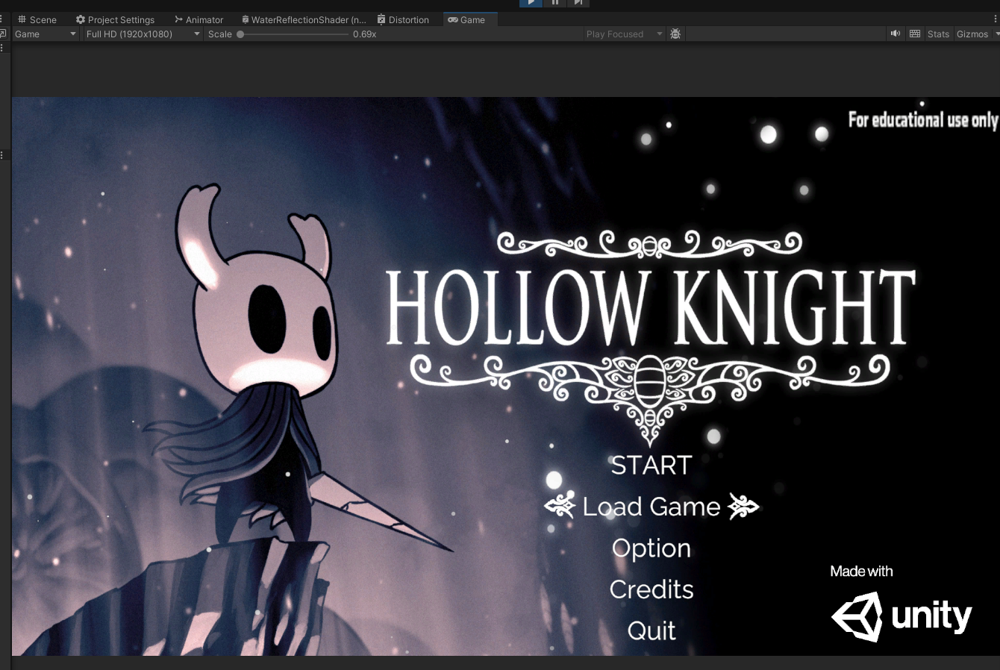
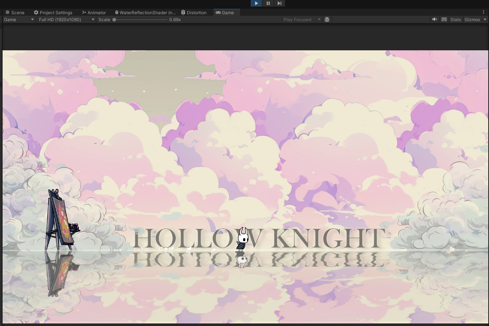
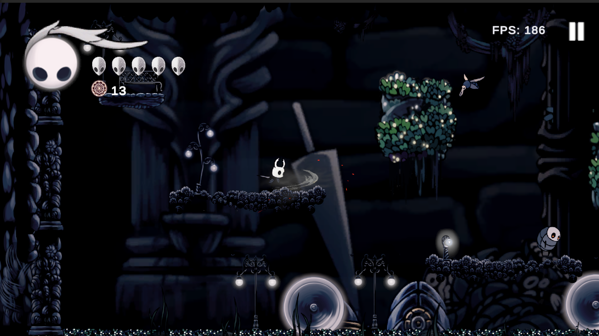
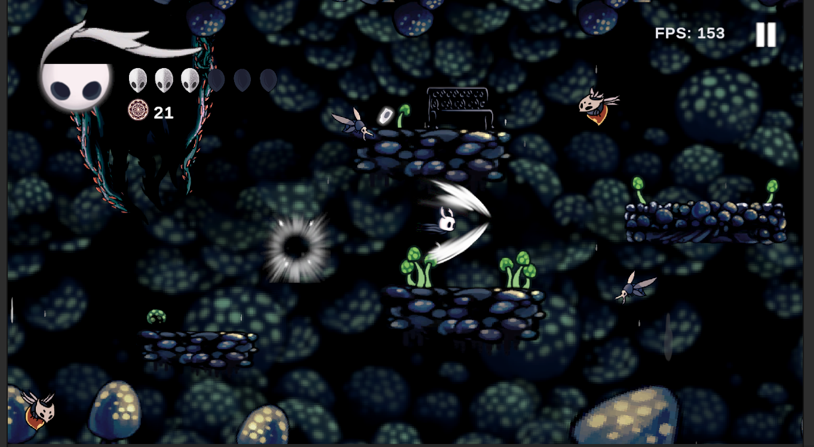
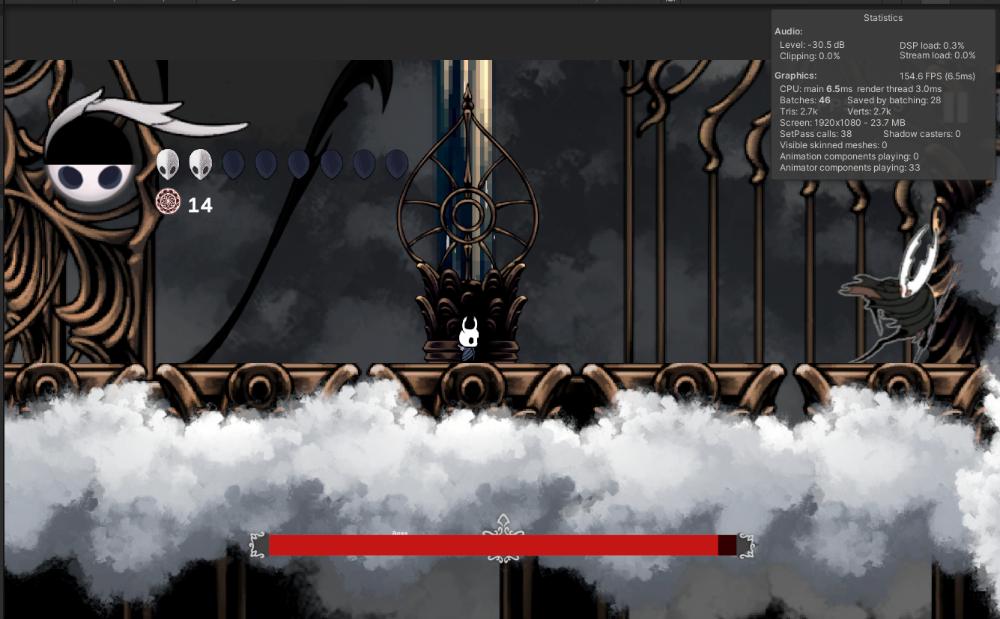
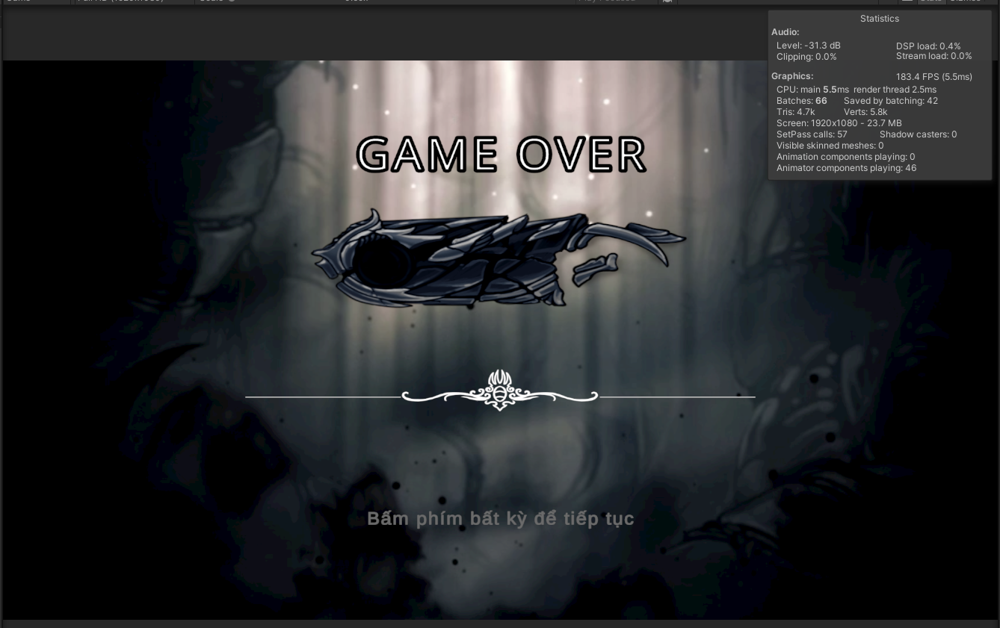

# 2D-Game-Platformer-Personal-Project
WORK IN PROGRESS

This is a learning project where I am developing a 2D platformer and action-adventure game inspired by *Hollow Knight*, built using Unity. The project serves as a hands-on experience to explore game development concepts such as level design, AI behavior, and sprite integration, animation and more.

The game is currently in development, and this repository contains the project files and assets.
-------------
### Features
- Gameplay Mechanic:
  - 2D platformer mechanics including movement, jumping, and dashing.
  - Basic combat system
  - Level design that encourages exploration and discovery.
- AI-controlled enemies with custom behaviors such as roaming, attacking, chasing.
- Player health, mana, and ability system that unlock as the game progress.
- Map and enviroment inspired by Hollow Knight.
- Basic Audio design: dynamic background music for different levels.
-------------
### Technologies & Tool used
- Unity 6.3 LTS (6000.3.22f1).
- C#: Programming language for gameplay mechanics.
- Aseprite: Sprite design and animation.
- Adobe Photoshop: Image editing and asset creation.
- Git: Version control system.
-------------
### Ingame Screenshots
- **Main Menu UI**

- **Tutorial Scene**

- **Map 1**

- **Map 2**

- **Map 3**

- **GameOver Scene**

-------------
### How to Play
- **Clone:**
  - Clone this repository:
    ```
    git clone https://github.com/Quochung2497/2D-Game-Platformer-Personal-Project.git
    ```
  - Open project in Unity 6.3 LTS (6000.3.22f1).
  - Let Unity restore the packages, then choose **Window > TextMeshPro > Import TMP Essential Resources** and import the package before entering Play Mode or building.
  - The generated `Assets/TextMesh Pro` folder is local and ignored by Git. Project-specific fonts are versioned separately in `Assets/ProjectFonts`; keep their `.meta` files to preserve UI references.
  - Press Play in Unity Editor
- **Install:**
  - **Itch.io:** [download](https://quochung020497.itch.io/)
-------------
### Commit message checks
Use `type: description`, with an optional scope and breaking-change `!`, for example `fix(player): restore jump input`. Accepted types are `feat`, `fix`, `chore`, `doc`, `docs`, `refactor`, `test`, `ci`, `build`, `perf`, `style` and `revert` (case-insensitive). Actual merge commits keep Git's generated subject.

Install the shared hook once per clone from Git Bash, and repeat after updating `.githooks/commit-msg`:

```bash
cp .githooks/commit-msg "$(git rev-parse --git-common-dir)/hooks/commit-msg"
chmod +x "$(git rev-parse --git-common-dir)/hooks/commit-msg"
git config --local core.hooksPath "$(git rev-parse --path-format=absolute --git-common-dir)/hooks"
```

The installed hook remains available when switching branches. The **Commit Message** workflow applies the same hook to non-merge commits in pull requests targeting `master`; a manual run validates the latest non-merge commit.
-------------
### Automated Windows builds
- **Target:** Windows 64-bit, Mono, Unity 6.3 LTS (6000.3.22f1). The build includes all nine enabled scenes, starting with Intro.
- **Render pipeline:** desktop builds retain the existing URP Compatibility Mode through the `URP_COMPATIBILITY_MODE` scripting define.
- **PR Validation:** pull requests targeting `master` run repository metadata/GUID/JSON checks and a Windows desktop build. A manual validation run is also available in Actions.
- **Unity credentials:** configure repository Actions secrets `UNITY_EMAIL` and `UNITY_PASSWORD` with the Unity account used for CI. Fork PRs do not receive these secrets.
- **TMP:** CI imports TMP Essential Resources from the restored UGUI package before building. The generated resources stay outside Git; custom fonts remain in `Assets/ProjectFonts`.
- **Release:** pushing a tag matching `build-v*` (for example, `build-v0.1.0`) reuses validation and publishes `Metroidvania-<tag>-Windows64.zip` as a GitHub Release asset. Rerunning the same tag replaces its ZIP.
- **Run the demo:** extract the entire ZIP and launch `Metroidvania.exe`. Keep `Metroidvania_Data`, `UnityPlayer.dll`, `MonoBleedingEdge` and the other packaged files beside the executable.
-------------
### Future Plans & Updates
- **Combat System Update:**
  - Introduce a talisman system that provides various buffs, debuffs, or special abilities.
  - Implement unique special abilities and spells to diversify gameplay.
  - Enhance attack combos and refine block/counter mechanics for more dynamic combat.
- **Levels:**
  -  **Redesign level to enhance user experience** and introduce additional unique challenges.
  -  Create more interactive elements, such as destructible environments, to immerse players further in the game world.
- **Enhanced Enemy AI:**
  - Add new enemy types, each with distinct and varied attack patterns.
  - Improve enemy AI to make combat encounters more challenging and engaging, pushing players to adapt and strategize.
- **Boss Fights:**
  - Implement major boss battles inspired by Hollow Knight.
  - **Redesign and enhance boss AI behavior** and **improve boss mechanics** for more engaging and challenging encounters.
- **UI/UX Improvements:**
  - Create more customizable settings for the options menu, including controller configuration, keyboard remapping, language settings, sound, graphics options,...etc.
  - Redesign existing HUD elements (player, boss, enemy, interactable objects, inventory, talisman, etc.) to enhance user experience, making them more visually appealing and easier to navigate.
- **Audio Enhancements:**
  - Implement multiple audio types (BGM, sound effects, environmental sounds, etc.) to better manage and enhance the overall sound experience.
  - Refine sound effects for a more immersive and accurate auditory experience in both combat and environmental interactions.
- **Optimization:**
  - Optimize game performance to ensure smoother gameplay, even on lower-end devices.
  - Reduce game file size efficiently without significantly compromising on visual or audio quality.
  - Implement more design pattern to optimize game performance (Object pooling, Observer pattern, Command Pattern ,..)
-------------
### Resources
For those interested in *Hollow Knight* sprites, you can find resources below:  
- **Hollow Knight Sprites (Voidheart Edition) 1.4.3.2:** [Google Drive Link](https://drive.google.com/drive/folders/1lx02_w9TFTYdR3aggI1gbXcLr69roaNV)  
- **Other Sprite Resources:** [Spriters-Resource](https://www.spriters-resource.com/pc_computer/hollowknight/)
